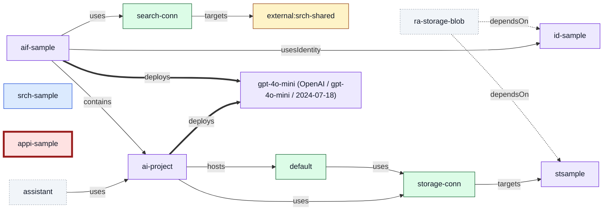

<!-- Generated from samples/graph/fixtures/combined.json by TestSamples in internal/report/graph; regenerate with `go test ./internal/report/graph -run TestSamples -update`. -->

# Foundry Doctor graph (combined)

| Class | Meaning | Non-colour cue |
|---|---|---|
| local | Declared in source; not in the deployed inventory (combined mode) or source-only (source mode) | solid outline |
| azure | Present in deployed Azure state only | solid outline |
| both | Declared in source and correlated with deployed Azure state | solid outline |
| unobserved | Declared in source, or referenced in scope, with a type the deployed inventory cannot observe, so its deployment is unknown | dotted outline |
| external | Referenced outside the graphed scope | solid outline |
| missing | Referenced but unresolved: a name that matches nothing, or an in-scope ARM ID of an observable type the inventory did not return | dashed outline |
| collapsed | Summary bucket for nodes over the size limit | dashed outline |
| unhealthy | Failed or canceled provisioning, connection error, or an error finding | thick outline |
| baselined | Has baselined findings | fine-dashed outline |
| added, removed, changed | Diff graph only: node state of target compared with base | thick or long-dashed outline |

- Nodes: 13
- Edges: 13

## Nodes

| ID | Label | Kind | Classes | Details |
|---|---|---|---|---|
| n1 | ra-storage-blob | role | unobserved, baselined | baselined 1 |
| n2 | aif-sample | foundry-account | both | health succeeded |
| n3 | id-sample | identity | both | health succeeded |
| n4 | srch-sample | search | local |  |
| n5 | stsample | storage | both | health succeeded, findings 1 (max warning) |
| n6 | appi-sample | monitoring | azure, unhealthy | health failed |
| n7 | search-conn | connection | azure |  |
| n8 | storage-conn | connection | azure |  |
| n9 | external:srch-shared | external | external |  |
| n10 | default | capability-host | azure | health succeeded |
| n11 | gpt-4o-mini (OpenAI / gpt-4o-mini / 2024-07-18) | model | both | health running |
| n12 | ai-project | project | both | health succeeded |
| n13 | assistant | agent | unobserved |  |

## Edges

| From | To | Kind | Details |
|---|---|---|---|
| n1 | n3 | dependsOn |  |
| n1 | n5 | dependsOn |  |
| n2 | n3 | usesIdentity |  |
| n2 | n7 | uses |  |
| n2 | n11 | deploys |  |
| n2 | n12 | contains |  |
| n7 | n9 | targets | external |
| n8 | n5 | targets |  |
| n10 | n8 | uses |  |
| n12 | n8 | uses |  |
| n12 | n10 | hosts |  |
| n12 | n11 | deploys |  |
| n13 | n12 | uses |  |
