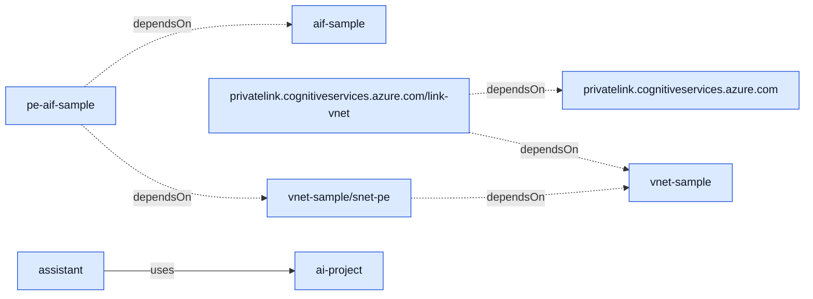

<!-- Generated from samples/graph/fixtures/private-network.json by TestSamples in internal/report/graph; regenerate with `go test ./internal/report/graph -run TestSamples -update`. -->

# Foundry Doctor graph (source)

| Class | Meaning | Non-colour cue |
|---|---|---|
| local | Declared in source; not in the deployed inventory (combined mode) or source-only (source mode) | solid outline |
| azure | Present in deployed Azure state only | solid outline |
| both | Declared in source and correlated with deployed Azure state | solid outline |
| unobserved | Declared in source, or referenced in scope, with a type the deployed inventory cannot observe, so its deployment is unknown | dotted outline |
| external | Referenced outside the graphed scope | solid outline |
| missing | Referenced but unresolved: a name that matches nothing, or an in-scope ARM ID of an observable type the inventory did not return | dashed outline |
| collapsed | Summary bucket for nodes over the size limit | dashed outline |
| unhealthy | Failed or canceled provisioning, connection error, or an error finding | thick outline |
| baselined | Has baselined findings | fine-dashed outline |
| added, removed, changed | Diff graph only: node state of target compared with base | thick or long-dashed outline |

- Nodes: 8
- Edges: 6

## Nodes

| ID | Label | Kind | Classes | Details |
|---|---|---|---|---|
| n1 | aif-sample | foundry-account | local |  |
| n2 | privatelink.cognitiveservices.azure.com/link-vnet | network | local | conditional |
| n3 | privatelink.cognitiveservices.azure.com | network | local |  |
| n4 | pe-aif-sample | network | local |  |
| n5 | vnet-sample/snet-pe | network | local |  |
| n6 | vnet-sample | network | local |  |
| n7 | ai-project | project | local |  |
| n8 | assistant | agent | local |  |

## Edges

| From | To | Kind | Details |
|---|---|---|---|
| n2 | n3 | dependsOn |  |
| n2 | n6 | dependsOn |  |
| n4 | n1 | dependsOn |  |
| n4 | n5 | dependsOn |  |
| n5 | n6 | dependsOn |  |
| n8 | n7 | uses |  |
